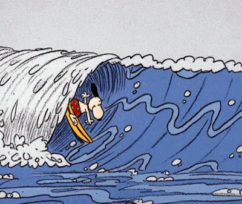

# hi, i'm amber! ♡

*designing little things, building big ideas.*

♡ ui/ux design &nbsp;·&nbsp; web development &nbsp;·&nbsp; data analytics ♡

---

### ♡ about me

I'm an undergraduate IT student from the Philippines who enjoys exploring the intersection of **design, technology, and creativity**.

I love turning ideas into thoughtful digital experiences, whether that's designing interfaces, developing applications, or working with data.

- 🎨 interested in UI/UX and visual design
- 🌷 currently improving my development and analytics skills
- 💻 enjoy working on web and mobile applications
- ☕ always learning, creating, and experimenting

### ♡ tech stack

**development**

**design & creative tools**

**data & analytics**

### ♡ featured projects

**🌷 [Autivity](https://github.com/depenaezra/autivity)**

A capstone project focused on providing personalized developmental learning activities for learners with Autism Spectrum Disorder (ASD), featuring AI-assisted recommendations and progress tracking.

**🖥️ [Autivity Web](https://github.com/ambergwenn/autivity-web)**

A website developed as part of the Autivity project.

**📱 [React Native Projects](https://github.com/ambergwenn/react-native-projects)**

A collection of mobile development projects built using React Native and Expo Go.

### ♡ github activity

### ♡ find me here

---

*thanks for visiting my little corner of github! ♡*

